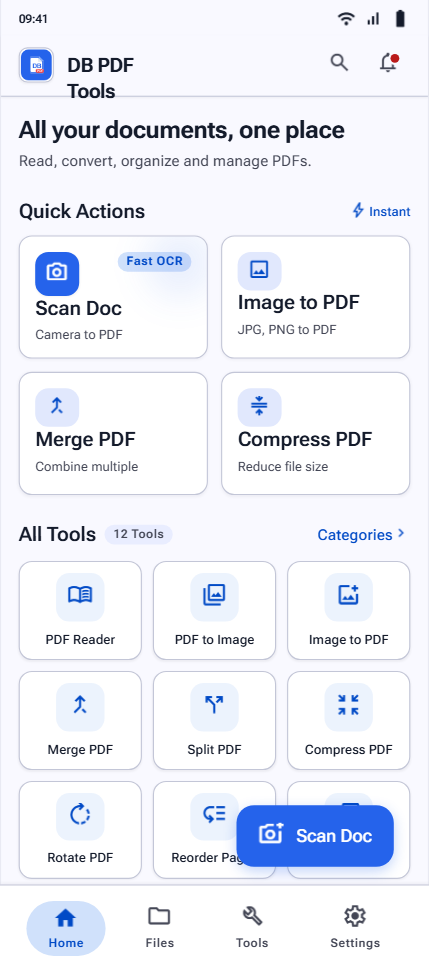

# DB PDF Tools 📄✨

A modern, high-performance Flutter application for all your PDF workflows: scanning documents with OCR, converting images to PDF, merging, compressing, securing, and managing PDF files on Android, iOS, and Web. Powered by Supabase cloud storage and synchronization.



---

## 🌟 Key Features

- **⚡ Fast Quick Actions**:
  - **Scan Doc**: Live camera scanner with high-speed Optical Character Recognition (OCR).
  - **Image to PDF**: Select pictures and compile high-resolution multi-page PDF documents.
  - **Merge PDFs**: Select and combine multiple PDF files in custom order into a unified document.
  - **Compress**: Optimize and shrink large PDF file sizes efficiently.
- **🛠️ 12 PDF Productivity Tools**:
  - Split PDF, PDF to Word, Word to PDF, PDF to Excel, Excel to PDF
  - Sign PDF, Watermark, Protect PDF, Unlock PDF, Organize Pages, Rotate Pages, OCR Text Extract
- **☁️ Supabase Cloud Synchronization**:
  - Automated cloud document synchronization with PostgreSQL & Row Level Security (RLS).
  - Real-time recent files synchronization and cloud storage.
- **📱 Cross-Platform Support**:
  - Native Android (Material 3 with custom brand styling)
  - iOS
  - Progressive Web App (PWA)
- **💎 Clean UI & Premium UX**:
  - HSL tailored palette with vibrant primary cyan accents (`#00D2B4`) and deep dark mode.
  - AdMob native ad container.
  - Pro Subscription tiers with high-conversion checkout previews.

---

## 📁 Project Architecture

```
lib/
├── core/
│   ├── config/
│   │   └── supabase_config.dart     # Supabase credentials & initialization
│   ├── theme/
│   │   ├── app_colors.dart          # Design system color tokens
│   │   ├── app_theme.dart           # Light/Dark ThemeData configurations
│   │   └── app_typography.dart      # Google Fonts typography hierarchy
│   └── utils/
├── data/
│   ├── models/
│   │   └── pdf_document_model.dart  # Data transfer models & JSON serialization
│   └── repositories/
│       └── pdf_repository.dart      # Data repository with Supabase integration
├── domain/
│   └── models/
│       └── document_item.dart       # Core domain entity models
├── ui/
│   ├── common/                      # Shared widgets (buttons, cards, banners)
│   └── features/
│       ├── files/                   # Document list & filter view
│       ├── home/                    # Home dashboard view
│       ├── reader/                  # In-app document viewer modal
│       ├── scanner/                 # Camera scanner & OCR modal
│       ├── settings/                # Settings & Pro subscription view
│       └── tools/                   # All PDF tools grid & action dialogs
└── main.dart                        # Application entry point
```

---

## 🚀 Getting Started

### Prerequisites

- [Flutter SDK](https://docs.flutter.dev/get-started/install) (v3.13 or newer)
- Java 17 (OpenJDK 17 recommended for Android Gradle builds)
- Android SDK (API 34)

### Running Locally

1. **Clone the repository**:
   ```bash
   git clone https://github.com/db-crud/PDFtools.git
   cd PDFtools
   ```

2. **Install dependencies**:
   ```bash
   flutter pub get
   ```

3. **Run on Chrome / Web**:
   ```bash
   flutter run -d chrome
   ```

4. **Run on Android device / emulator**:
   ```bash
   flutter run -d android
   ```

5. **Build Release APK**:
   ```bash
   flutter build apk --release
   ```
   The APK will be generated at:
   `build/app/outputs/flutter-apk/app-release.apk`

---

## 🤖 Automated CI/CD (GitHub Actions)

This repository includes automated GitHub Actions workflow (`.github/workflows/build_apk.yml`) that automatically builds and publishes downloadable release APK artifacts whenever you push or tag a release.

---

## 📄 License & Copyright

© 2026 DB PDF Tools. All rights reserved.
